# HelpDesk

**Name:** Prince Kumar · **Roll No:** 24bc10658 · **DevOps course, Session 21 final capstone**

**▶ [Demo video (Google Drive, 14 min)](https://drive.google.com/file/d/1XKZFxCKt3bHWjRsZ8xwDCqDI7-ifr4Tv/view?usp=sharing)** · **[Slides (PDF)](demo/HelpDesk-Presentation.pdf)** · **[Slides (PPTX)](demo/HelpDesk-Presentation.pptx)**

**HelpDesk is a customer-support ticketing app.** Customers raise tickets (a bug, a billing question, a feature request). Support agents assign them, reply to the customer or leave internal notes, and move each ticket through `OPEN → IN_PROGRESS → RESOLVED → CLOSED`. A dashboard shows the live queue: open, in progress, urgent, unassigned and resolved, plus where requests come from.

The app is deliberately small. The project is the delivery system around it. Every commit is linted, tested and security-scanned by GitHub Actions, built into images tagged with the commit SHA, and published to GitHub Container Registry. The pipeline then commits the new tag to Git, and Argo CD deploys it to AWS EKS. Prometheus and Grafana watch the app, and Terraform built the AWS network and cluster it runs on.

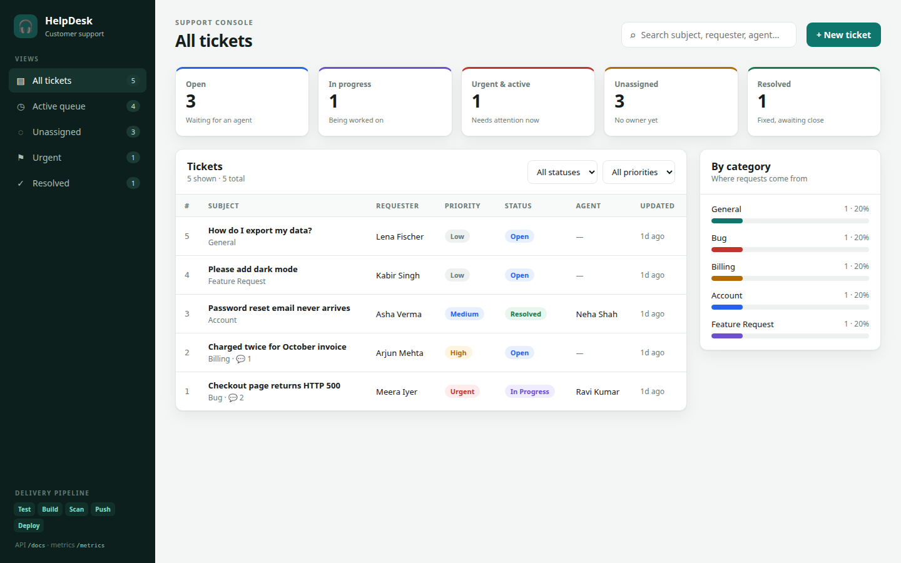

**Where to look**

| | |
|---|---|
| **Demo video (14 min)** | **[Watch on Google Drive](https://drive.google.com/file/d/1XKZFxCKt3bHWjRsZ8xwDCqDI7-ifr4Tv/view?usp=sharing)**: narrated walkthrough of slides, codebase, CI/CD, Terraform, Argo CD, Kubernetes, Prometheus and Grafana (a copy is in [`demo/HelpDesk-Presentation.mp4`](demo/HelpDesk-Presentation.mp4)) |
| **Slide deck (15 slides)** | [`demo/HelpDesk-Presentation.pdf`](demo/HelpDesk-Presentation.pdf) · [`.pptx`](demo/HelpDesk-Presentation.pptx) |
| Every rubric item and its proof | [`evidence/README.md`](evidence/README.md): 40 screenshots plus raw command output |
| A green pipeline run | [Run #9](https://github.com/princekumar0509/Helpdesk/actions/runs/38956576525): test → build + Trivy + push → GitOps commit → rollout verified on EKS |
| Narration script | [`demo/SCRIPT.md`](demo/SCRIPT.md) |
| Troubleshooting labs | [`troubleshooting/`](troubleshooting/) |
| Terraform details | [`terraform/README.md`](terraform/README.md) |

## Contents

1. [Architecture](#1-architecture)
2. [Technologies](#2-technologies)
3. [Repository layout](#3-repository-layout)
4. [Application and API](#4-application-and-api)
5. [Docker](#5-docker)
6. [CI/CD pipeline](#6-cicd-pipeline)
7. [DevSecOps](#7-devsecops)
8. [Terraform: AWS VPC + EKS](#8-terraform-aws-vpc--eks)
9. [Kubernetes and Helm](#9-kubernetes-and-helm)
10. [Monitoring](#10-monitoring)
11. [GitOps with Argo CD and the live demo](#11-gitops-with-argo-cd-and-the-live-demo)
12. [Troubleshooting](#12-troubleshooting)
13. [Cost and teardown](#13-cost-and-teardown)
14. [Known issues and limitations](#14-known-issues-and-limitations)
15. [Lessons learned](#15-lessons-learned)

## 1. Architecture

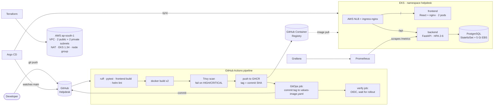

**A request:** the browser reaches the AWS load balancer and the Ingress. `/` goes to the frontend (nginx serving the React build), and `/api` goes to the backend (FastAPI), which talks to PostgreSQL. Prometheus scrapes the backend's `/metrics` inside the cluster.

**A change:** a commit to `main` runs the pipeline. The images are pushed only if every test and scan passes, and then the new tag is committed to [`helm/helpdesk/values-image.yaml`](helm/helpdesk/values-image.yaml). Argo CD sees that commit and rolls it out. **CI never pushes to the cluster, and no AWS keys are stored in GitHub.** The verify job signs in through OIDC only to confirm the rollout. Rolling back is `git revert`.

## 2. Technologies

| Area | Tools |
|---|---|
| Frontend | React 19, Vite, responsive CSS (light and dark), served by unprivileged nginx |
| Backend | Python 3.12, FastAPI, SQLAlchemy 2, Pydantic 2, Alembic migrations |
| Database | PostgreSQL 16 (StatefulSet + EBS volume on EKS; in-memory SQLite in tests) |
| Tests | pytest (19 tests), ruff, Node test runner |
| Containers | Docker multi-stage builds, non-root users, Docker Compose |
| CI/CD | GitHub Actions, GitHub Container Registry, GitHub OIDC to AWS |
| Security | Trivy image scans (fail on fixable HIGH/CRITICAL), non-root images, dropped capabilities, Pod Security labels |
| Infrastructure | Terraform: AWS VPC, EKS 1.34, managed node group, IAM, EBS CSI, metrics-server |
| Kubernetes | Helm chart, ingress-nginx (AWS NLB), HPA |
| Observability | kube-prometheus-stack (Prometheus, Alertmanager, Grafana), prometheus-fastapi-instrumentator |
| GitOps | Argo CD 3.5 (auto-sync, prune, self-heal) |

## 3. Repository layout

| Path | What it is |
|---|---|
| [`backend/`](backend/) | FastAPI app: `app/` (routes, models, schemas, DB), `alembic/versions/` migration, `tests/` (19 tests), `Dockerfile` |
| [`frontend/`](frontend/) | React + Vite UI, `nginx.conf.template`, multi-stage `Dockerfile` |
| [`docker-compose.yml`](docker-compose.yml) | the whole stack locally: PostgreSQL, backend, frontend |
| [`.github/workflows/ci-cd.yml`](.github/workflows/ci-cd.yml) | the CI/CD pipeline (4 jobs) |
| [`terraform/`](terraform/) | AWS VPC + EKS + IAM, and the GitHub OIDC deploy role |
| [`k8s/`](k8s/) | `namespace.yaml` and the RBAC that lets CI manage the ServiceMonitor |
| [`helm/helpdesk/`](helm/helpdesk/) | the Helm chart, plus `values-prod.yaml` (EKS), `values-dev.yaml` (local) and `values-image.yaml` (tags set by CI) |
| [`argocd/`](argocd/) | Argo CD install values and the HelpDesk `Application` |
| [`monitoring/`](monitoring/) | kube-prometheus-stack values and alert rules |
| [`troubleshooting/`](troubleshooting/) | three deliberately broken manifests with investigation and fix steps |
| [`scripts/`](scripts/) | `seed-data.sh` (demo tickets), `load-test.sh` (traffic for Grafana and the HPA) |
| [`evidence/`](evidence/) | screenshots and raw command output for every module |
| [`demo/`](demo/) | presentation video, slides, narration script |

## 4. Application and API

| Endpoint | Purpose |
|---|---|
| `GET /api/tickets?status=&priority=&category=&q=` | list, filter and search tickets, newest first |
| `POST /api/tickets` | create a ticket (always starts `OPEN`) |
| `GET` / `PUT` / `DELETE /api/tickets/{id}` | read, update (status, priority, agent…), delete |
| `GET` / `POST /api/tickets/{id}/comments` | conversation thread; a reply from the assigned agent moves `OPEN → IN_PROGRESS` |
| `GET /api/tickets/stats` | counts by status and category, urgent-active and unassigned |
| `GET /health`, `/ready`, `/metrics` | liveness, readiness (database reachable), Prometheus metrics |

Interactive docs are at `/docs` (Swagger UI). The schema (`tickets`, `ticket_comments`) is created by the Alembic migration [`0001_create_tickets.py`](backend/alembic/versions/0001_create_tickets.py).

Run the tests (no database needed; each test gets a fresh in-memory SQLite database through [`conftest.py`](backend/tests/conftest.py)):

```bash
cd backend && python3 -m venv .venv && . .venv/bin/activate
pip install -r requirements-dev.txt
ruff check . && pytest -v
```

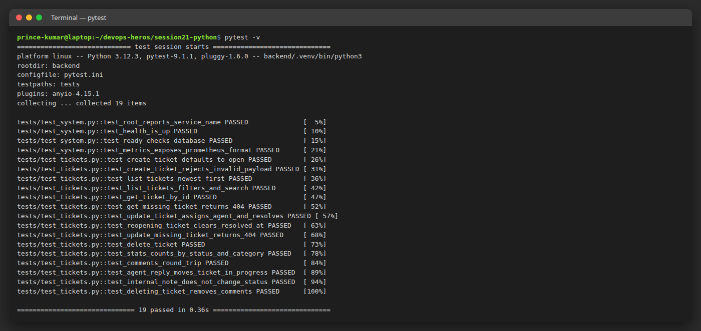

## 5. Docker

- **Backend** ([`backend/Dockerfile`](backend/Dockerfile)): two stages. Dependencies are installed into a virtualenv in a build stage. The runtime is `python:3.12-slim` running as **uid 10001**, with `pip` removed.
- **Frontend** ([`frontend/Dockerfile`](frontend/Dockerfile)): **multi-stage**. Node 22 builds the static files, and the runtime is `nginx-unprivileged` running as **uid 101**, with no Node at all.
- **Compose** ([`docker-compose.yml`](docker-compose.yml)): PostgreSQL with a health check. The backend waits for the database and runs the migration; the frontend waits for the backend.

```bash
docker compose up --build        # UI: http://localhost:3000   API docs: http://localhost:8000/docs
./scripts/seed-data.sh           # optional: demo tickets
```

Postgres is published on `127.0.0.1:5433`, so it doesn't clash with a local Postgres. Stop with `docker compose down`; add `-v` to delete the data too.

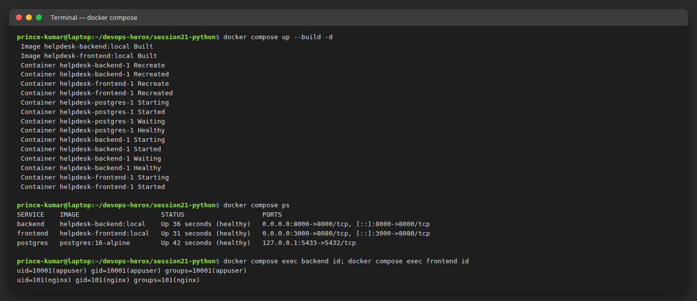

## 6. CI/CD pipeline

[`ci-cd.yml`](.github/workflows/ci-cd.yml) runs on every push and pull request to `main`, and can also be started by hand.

```text
test ──► build-scan-push ──────────────────────► gitops ──────────────────────► verify
│        docker build x2 (tag = commit SHA)      commit the new tag to            OIDC to AWS, wait until
│        Trivy: fail on fixable HIGH/CRITICAL    helm/helpdesk/values-image.yaml  both Deployments on EKS
│        push both images to GHCR                ([skip ci]); Argo CD syncs it    run this commit
ruff · pytest (19) · npm test + build · helm lint
```

- **Tests come first.** If any test fails, nothing is built, scanned or pushed.
- **Tags are the full commit SHA,** never `latest`, so every running pod traces back to one commit.
- **The GitOps commit is the deployment.** It is made with the workflow's own token, so it doesn't start another run.
- **No stored cloud credentials.** The verify job gets short-lived AWS credentials through GitHub OIDC. The role trusts only this repository's `production` environment, and inside EKS it is limited to the `helpdesk` namespace.

One-time setup: after `terraform apply`, set the repository variables `AWS_DEPLOY_ROLE_ARN` and `EKS_CLUSTER_NAME` (from `terraform output`), and give this repository *Write* access to the two GHCR packages.

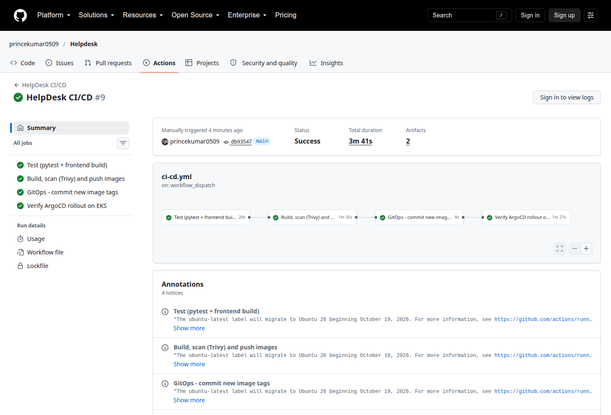
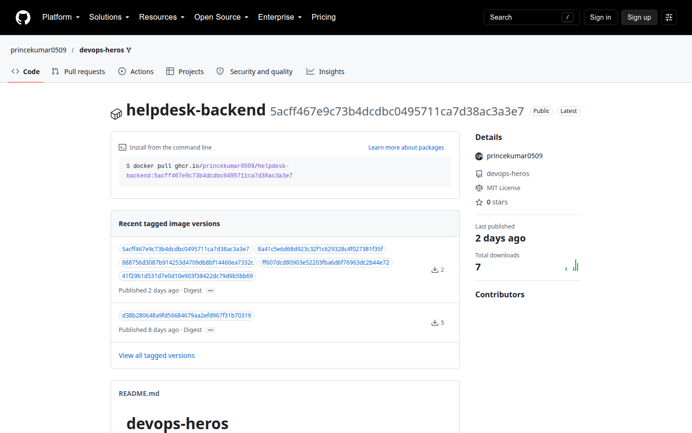

## 7. DevSecOps

| Control | How |
|---|---|
| Image scan | Trivy on both images in the pipeline: `HIGH,CRITICAL`, `ignore-unfixed`, `exit-code 1`, so a fixable high-severity CVE fails the build |
| Small attack surface | slim and Alpine base images, OS packages upgraded at build time, `pip` removed from the backend runtime |
| Runtime | non-root containers, all Linux capabilities dropped, seccomp `RuntimeDefault`, Pod Security labels on the namespace |
| Secrets | no keys in the repository: OIDC for AWS, the database password in a Kubernetes Secret, `.env` and `*.tfvars` git-ignored |

**What Trivy found:** both published images have **0 fixable HIGH or CRITICAL** vulnerabilities (the Debian 13 backend with 29 Python packages, and the Alpine frontend). That's deliberate. An early scan flagged HIGH CVEs in libraries bundled inside `pip` (`urllib3`, `msgpack`, `setuptools`), code the app never runs, so the multi-stage build drops `pip` from the runtime image instead of ignoring the findings. A clean scan doesn't mean "secure". It means no known, fixable, high-severity CVE was present at build time.

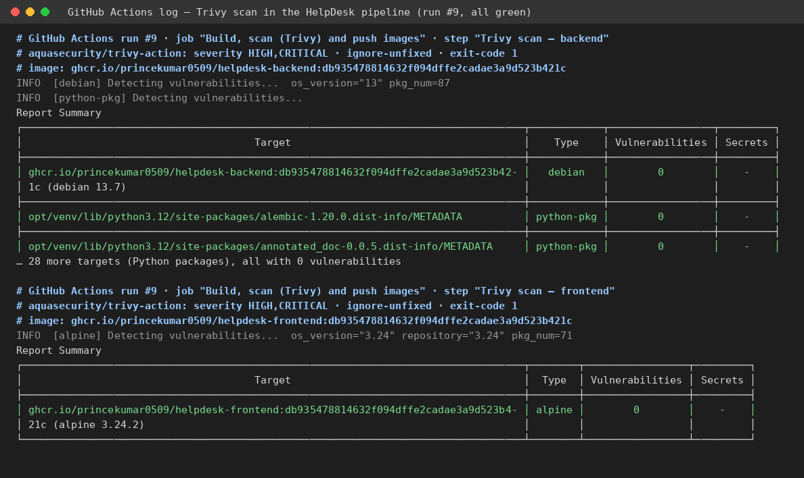

## 8. Terraform: AWS VPC + EKS

[`terraform/`](terraform/) plans **65 resources** in `ap-south-1` (Mumbai):

- a **VPC** (`10.20.0.0/16`) with **2 public subnets** (load balancers) and 2 private subnets (nodes) across two availability zones;
- an internet gateway, one NAT gateway and route tables;
- an **EKS 1.34** cluster with a managed **node group** of 2× `m7i-flex.large`;
- add-ons: the EBS CSI driver (for the Postgres volume, via EKS Pod Identity) and metrics-server (for the HPA);
- the IAM role GitHub Actions assumes through OIDC.

Choices made along the way:

- **`m7i-flex.large` nodes.** The AWS Free plan only launches free-tier instance types, and `t3.medium` was rejected. `m7i-flex.large` is eligible and has 8 GiB of memory.
- **No credentials in the repository.** Terraform ran as an IAM user whose key exists only in the local AWS CLI configuration. `terraform.tfvars` and the state are git-ignored; only [`terraform.tfvars.example`](terraform/terraform.tfvars.example) is committed.
- **No AWS calls during `plan`.** Availability zones are variables and the node AMI is EKS-managed, so a plan works even before EC2 is enabled on an account.

```bash
cd terraform
cp terraform.tfvars.example terraform.tfvars     # set github_repository; never put AWS keys here
terraform init && terraform plan -out=tfplan && terraform apply tfplan    # ~15–20 min
$(terraform output -raw configure_kubectl)
```

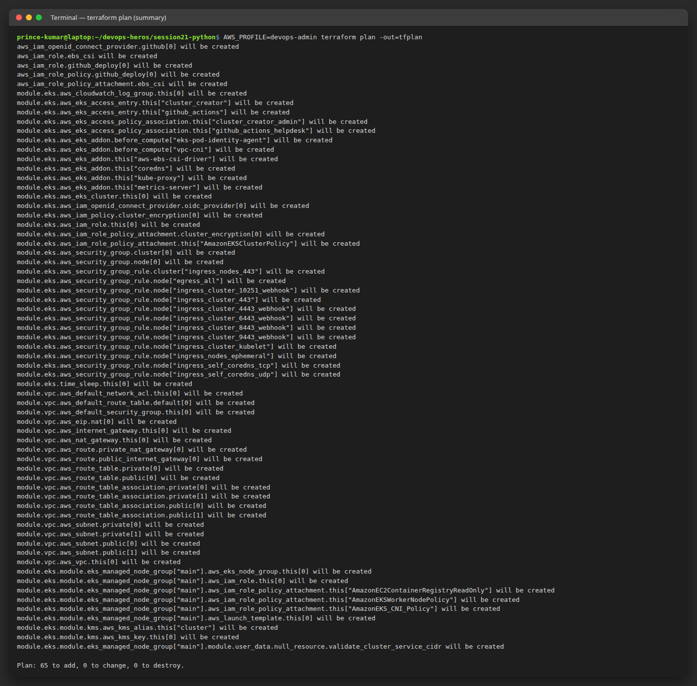
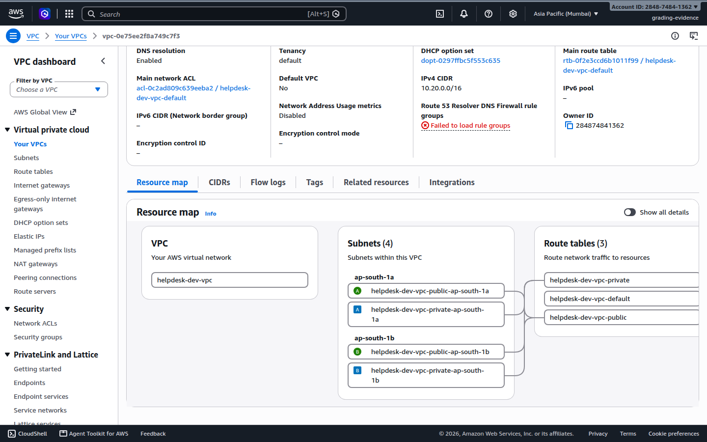
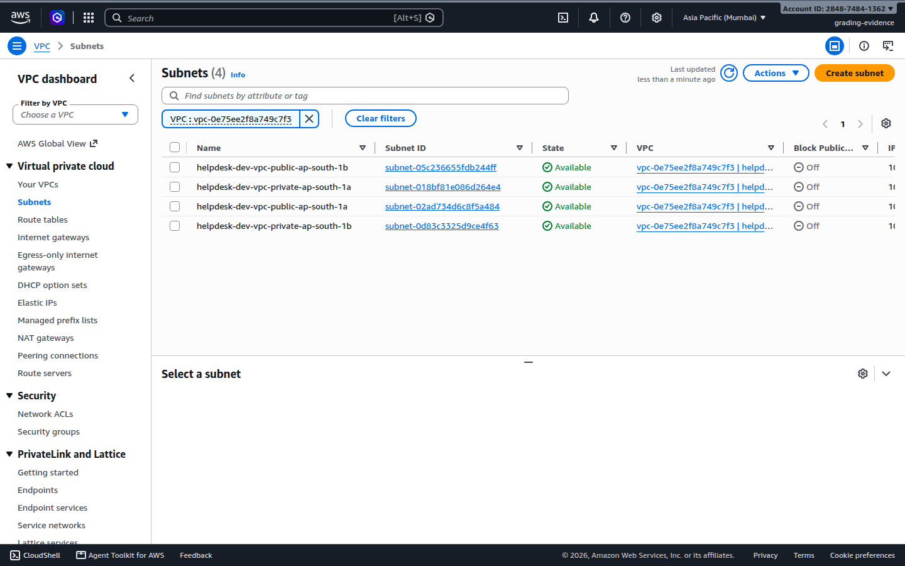
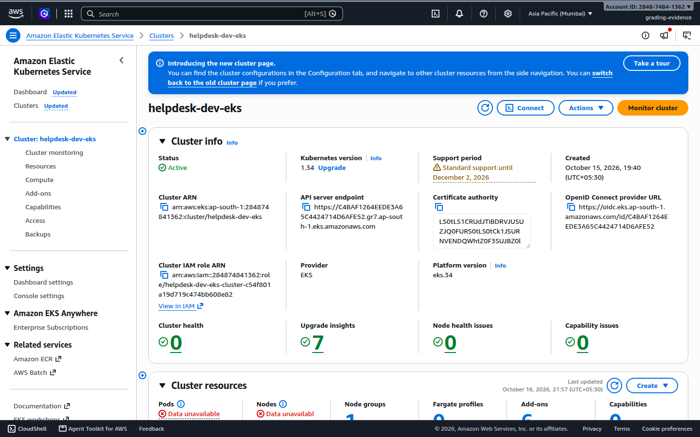
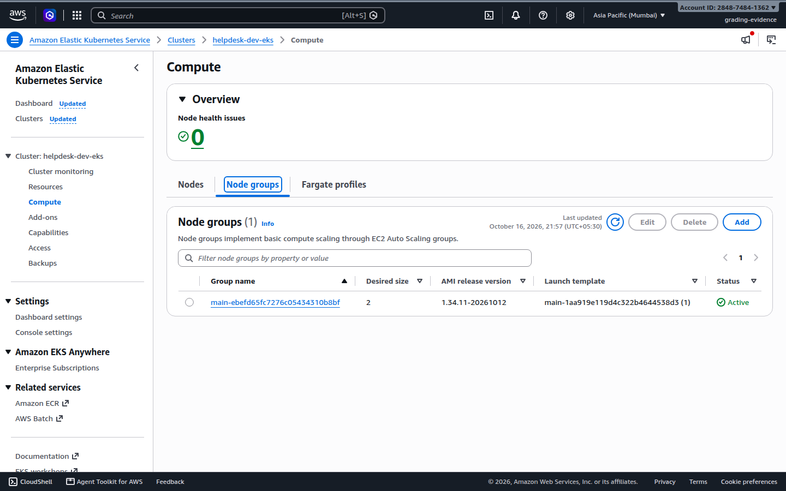

After the demo was recorded, everything was destroyed. The Kubernetes-created load balancer and EBS volume were removed first, then `terraform destroy` removed all 65 resources, and a check against AWS found nothing left:

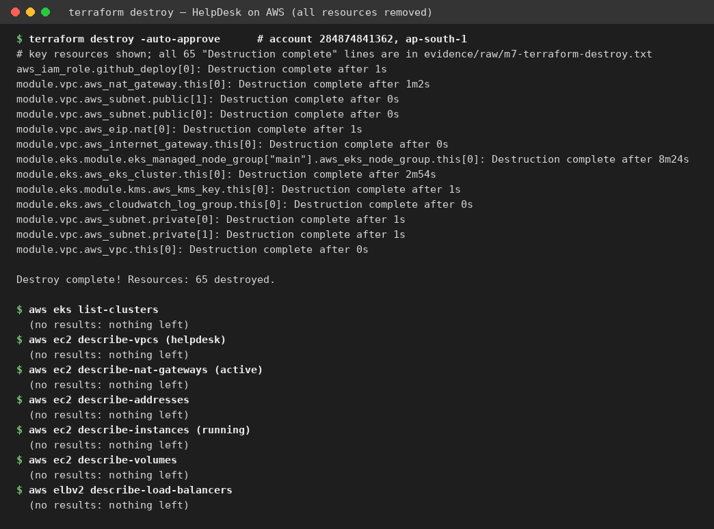

## 9. Kubernetes and Helm

The [`helm/helpdesk`](helm/helpdesk/) chart deploys:

- the backend: 2–6 replicas through the HPA (60 % CPU), startup, readiness and liveness probes, and an init container that waits for Postgres;
- the frontend: 2 replicas;
- PostgreSQL as a StatefulSet with a 5 Gi EBS volume;
- ClusterIP Services, and an Ingress (`/` → frontend, `/api` → backend);
- a ServiceMonitor and the "HelpDesk API" Grafana dashboard.

One-time cluster bootstrap after `terraform apply`:

```bash
kubectl apply -f k8s/namespace.yaml
kubectl annotate storageclass gp2 storageclass.kubernetes.io/is-default-class=true --overwrite   # EKS ≥ 1.30 has no default
helm upgrade --install ingress-nginx ingress-nginx --repo https://kubernetes.github.io/ingress-nginx \
  -n ingress-nginx --create-namespace \
  --set controller.service.annotations."service\.beta\.kubernetes\.io/aws-load-balancer-type"=nlb
helm repo add prometheus-community https://prometheus-community.github.io/helm-charts
helm upgrade --install kube-prometheus-stack prometheus-community/kube-prometheus-stack \
  -n monitoring --create-namespace -f monitoring/kube-prometheus-stack-values.yaml
```

The app itself is deployed by Argo CD (see [section 11](#11-gitops-with-argo-cd-and-the-live-demo)). Without Argo CD, for example on a local kind cluster, the equivalent is:

```bash
helm upgrade --install helpdesk ./helm/helpdesk -n helpdesk -f helm/helpdesk/values-prod.yaml -f helm/helpdesk/values-image.yaml
```

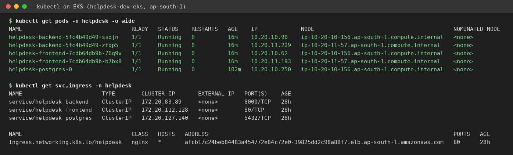
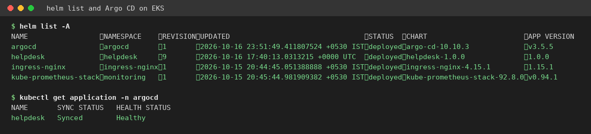

**Autoscaling:** under `scripts/load-test.sh`, backend CPU rises above the 60 % target and the HPA scales from 2 to 6 pods, then back to 2 when the load stops. The scaling on EKS is shown in the demo video.

```bash
kubectl get hpa -n helpdesk -w
URL=http://<ingress-address> CONCURRENCY=60 REQUESTS=400000 ./scripts/load-test.sh
```

## 10. Monitoring

kube-prometheus-stack is installed with [these values](monitoring/kube-prometheus-stack-values.yaml). The chart adds a **ServiceMonitor**, so Prometheus scrapes the backend's `/metrics`, and the **"HelpDesk API" dashboard**: request rate, 5xx ratio, p95 latency, backend pods up, requests per endpoint, responses by status class, p50/p95/p99 latency, and CPU per pod (what the HPA acts on). Two alert rules are defined: `HelpDeskHighErrorRate` and `HelpDeskBackendDown`.

```bash
kubectl port-forward -n monitoring svc/kube-prometheus-stack-prometheus 9090:9090   # Status → Targets
kubectl port-forward -n monitoring svc/kube-prometheus-stack-grafana 3001:80          # Dashboards → HelpDesk API
```

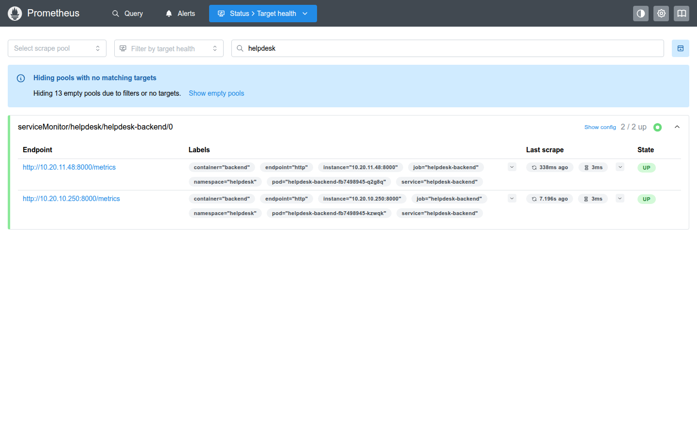
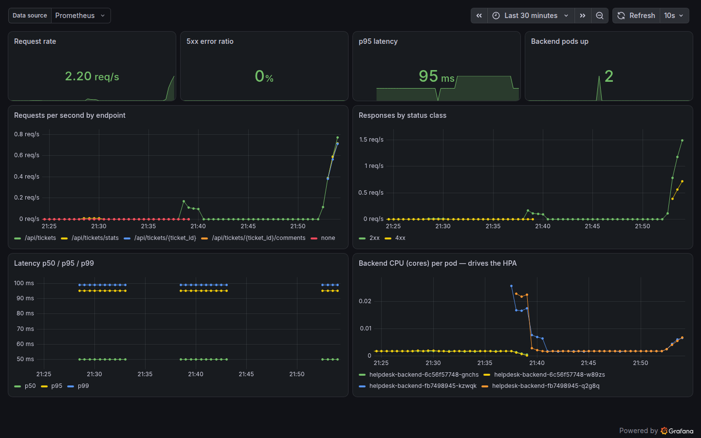

## 11. GitOps with Argo CD and the live demo

Argo CD runs in the cluster and keeps the `helpdesk` namespace equal to [`helm/helpdesk`](helm/helpdesk/) on `main` ([Application](argocd/helpdesk-application.yaml): automated sync, prune and self-heal; the HPA owns the backend replica count).

```bash
helm repo add argo https://argoproj.github.io/argo-helm
helm upgrade --install argocd argo/argo-cd --version 10.10.3 -n argocd --create-namespace -f argocd/argocd-values.yaml
kubectl apply -f argocd/helpdesk-application.yaml
kubectl get application helpdesk -n argocd      # Synced, Healthy
```

**The live demo, recorded in the video:**

1. The sidebar subtitle is changed in `Sidebar.jsx`, committed and pushed.
2. The pipeline runs: tests → build → Trivy → GHCR → GitOps commit.
3. Argo CD syncs the new tag, and a browser refresh shows "Customer support · v2 live demo".
4. **Self-heal:** the frontend is scaled to 4 by hand, and Argo CD puts it back to 2, as Git says, in about 20 seconds.

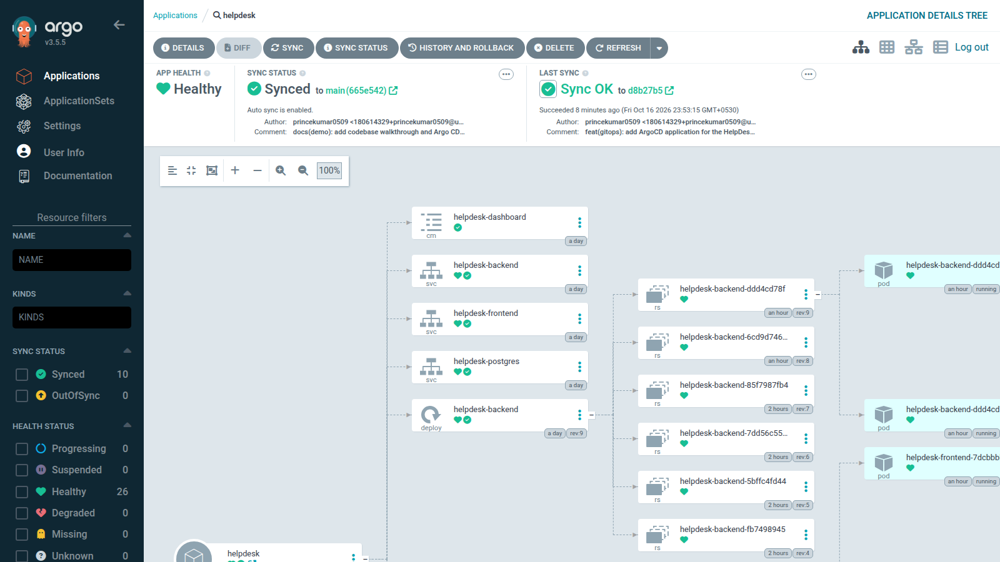

## 12. Troubleshooting

Each manifest in [`troubleshooting/`](troubleshooting/) has the symptoms, the commands to investigate and the fix in its header. The broken-image lab is run live on EKS in the demo video: `ImagePullBackOff` → `kubectl describe` shows the tag doesn't exist → fix the image → `Running` → clean up.

| Lab | Symptom | Lesson |
|---|---|---|
| `broken-image.yaml` | `ImagePullBackOff` | `kubectl describe pod`: the Events show the tag doesn't exist |
| `broken-service.yaml` | the Service has no endpoints | a Service finds pods only through label selectors, and `targetPort` must match the container port |
| `crashloop-bad-db.yaml` | `CrashLoopBackOff` | the image is fine but the config is wrong: `kubectl logs --previous` shows the database error |

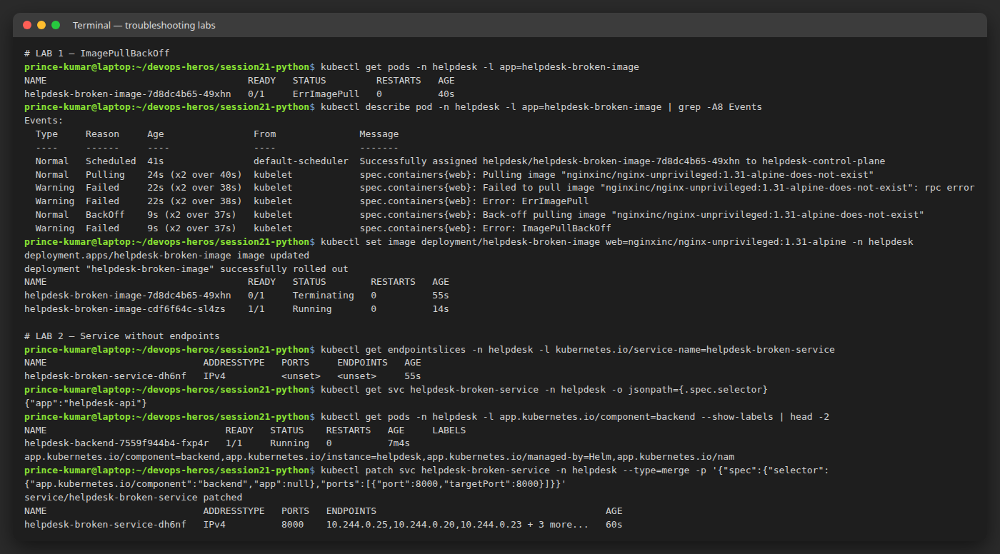

## 13. Cost and teardown

| What | Cost |
|---|---|
| GitHub repository, Actions, GHCR | free (public repository) |
| AWS: EKS control plane, NAT gateway, 2 nodes, load balancer | about $7 per day while it ran, paid from the AWS Free plan credits |

**Status: destroyed.** The AWS infrastructure was torn down after the demo was recorded (65 resources destroyed, nothing left in `ap-south-1`), so the load-balancer URL in the screenshots no longer works. The order below is the one that was used ([output](evidence/raw/m7-terraform-destroy.txt)).

Tear down in this order. Kubernetes created the load balancer and the EBS volume, so `terraform destroy` alone would leave them behind:

```bash
kubectl delete -f argocd/helpdesk-application.yaml     # Argo CD removes the app
helm uninstall argocd -n argocd
helm uninstall ingress-nginx -n ingress-nginx          # deletes the AWS load balancer
helm uninstall kube-prometheus-stack -n monitoring
kubectl delete pvc --all -n helpdesk                   # deletes the EBS volume
cd terraform && terraform destroy
```

## 14. Known issues and limitations

- **PostgreSQL runs in the cluster** as one replica: no replication, automated backups or point-in-time recovery. Production would use Amazon RDS.
- **One NAT gateway** keeps costs down, but it's a single point of failure for outbound traffic. Production would use one per AZ.
- **The Free plan caps the cluster at 2 nodes** (5-vCPU quota) and there's no Cluster Autoscaler, so the HPA scales pods but not nodes.
- **No TLS and no custom domain.** The app is plain HTTP on the load balancer's hostname. Production would add DNS, ACM or cert-manager, and HTTPS.
- **The app has no login.** Anyone with the URL can create or change tickets.
- **Terraform state is local.** An S3 backend is prepared but commented out in `terraform/versions.tf`.
- **Trivy uses `ignore-unfixed`.** CVEs with no fix available are reported but don't block the pipeline.
- **ingress-nginx is retired upstream.** It's kept because the course uses it. A newer setup would use the AWS Load Balancer Controller or Gateway API.
- **Argo CD polls Git every 60 seconds** (no webhook), so a deploy starts up to a minute after the GitOps commit.
- **The database Secret isn't managed by Argo CD.** Argo CD renders charts without cluster access and couldn't reuse a generated password, so the chart references the existing Secret through `postgres.existingSecret`. A fresh cluster would use Sealed Secrets or External Secrets.
- **Some screenshots in `evidence/`** were taken while the project lived in the `session21-python/` folder of `princekumar0509/devops-heros`. The full commit history was carried over to this repository.

## 15. Lessons learned

1. **Read the platform's error, not your code first.** EC2 calls failed with `OptInRequired`; the cause was an account verification that had failed, shown in AWS Health. A new, properly verified account fixed it.
2. **Account plans have rules.** The Free plan rejected `t3.medium` and, at first, load balancers. CloudTrail showed the exact reason ("not eligible for Free Tier").
3. **OIDC trust must match the token exactly.** The deploy role first trusted the branch, but a job with `environment:` sends the environment in `sub`. The repository also uses GitHub's immutable subject format, with numeric IDs.
4. **Least privilege has edges.** EKS's namespace-admin access policy doesn't cover CRDs, so Helm couldn't manage the ServiceMonitor. A tiny RBAC Role fixed it without granting cluster admin.
5. **Pin your tools.** `setup-helm` with `latest` once failed to look up the version, fell back to Helm 3, and broke a deploy that used a Helm 4 flag.
6. **GitOps changes what a chart may do.** Argo CD renders without cluster access, so Helm `lookup()` can't reuse a generated password. A deterministic chart is a requirement.
7. **Kubernetes creates cloud resources Terraform doesn't know about.** The load balancer and EBS volume must be removed first, or `terraform destroy` leaves them behind.
